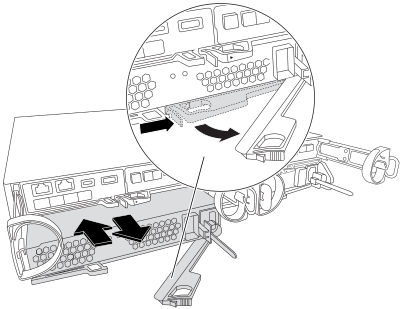

= FAS2820 시스템에서 전원 공급 장치 핫 스왑
:allow-uri-read: 
:icons: font
:imagesdir: ../media/

[role="lead"]
FAS2820 시스템의 전원 공급 장치에 문제가 발생하거나 성능이 저하될 경우, 시스템 작동을 중단하지 않고 핫 스왑 방식으로 교체할 수 있습니다. 이 절차는 고장난 전원 공급 장치를 끄고 제거한 다음, 교체용 전원 공급 장치를 설치하고 전원을 켜는 방식으로 진행됩니다.

시스템의 다른 구성 요소가 올바르게 작동하지 않는 경우 기술 지원 부서에 문의하십시오.

* 전원 공급 장치는 이중화되고 핫 스왑이 가능합니다.
* 이 절차는 한 번에 하나의 전원 공급 장치를 교체하기 위한 것입니다.
+

NOTE: 섀시에서 전원 공급 장치를 분리한 후 2분 이내에 교체하십시오. 시스템은 계속 작동하지만, 전원 공급 장치가 교체될 때까지 ONTAP은 콘솔에 전원 공급 장치 성능 저하에 대한 메시지를 보냅니다.

* 전원 공급 장치는 자동으로 범위가 조정됩니다.

.애니메이션 - 전원 공급 장치를 교체합니다
video::0631b48a-ad6f-4433-a2bd-af54014778c2[panopto]
.단계
. 콘솔 오류 메시지 또는 전원 공급 장치의 LED를 통해 교체할 전원 공급 장치를 식별합니다.
. 아직 접지되지 않은 경우 올바르게 접지하십시오.
. 전원 공급 장치를 끄고 전원 케이블을 뽑습니다.
+
.. 전원 공급 장치의 전원 스위치를 끕니다.
.. 전원 케이블 고정 장치를 연 다음 전원 공급 장치에서 전원 케이블을 뽑습니다.
.. 전원에서 전원 케이블을 뽑습니다.

. 전원 공급 장치 캠 핸들의 래치를 누른 다음 캠 핸들을 열어 중간 평면에서 전원 공급 장치를 완전히 분리합니다.
+

. 캠 핸들을 사용하여 전원 공급 장치를 시스템 밖으로 밀어냅니다.
+

CAUTION: 전원 공급 장치를 분리할 때는 항상 두 손을 사용하여 무게를 지탱하십시오.

. 새 전원 공급 장치의 전원 스위치가 꺼짐 위치에 있는지 확인합니다.
. 양손으로 전원 공급 장치의 가장자리를 시스템 섀시의 개구부에 맞춰 지지한 다음, 캠 핸들을 사용하여 전원 공급 장치를 섀시에 부드럽게 밀어 넣으십시오.
+
전원 공급 장치는 키 입력 방식이며 한 방향으로만 설치할 수 있습니다.

+

NOTE: 전원 공급 장치를 시스템에 밀어 넣을 때 과도한 힘을 가하지 마십시오. 커넥터가 손상될 수 있습니다.

. 래치가 잠금 위치에 딸깍 소리를 내며 전원 공급 장치가 완전히 장착되도록 캠 핸들을 닫습니다.
. 전원 공급 장치 케이블을 다시 연결합니다.
+
.. 전원 케이블을 전원 공급 장치와 전원에 다시 연결합니다.
.. 전원 케이블 리테이너를 사용하여 전원 공급 장치에 전원 케이블을 고정합니다.

+
전원 공급 장치에 전원이 복구되면 상태 LED가 녹색으로 켜져야 합니다.

. 새 전원 공급 장치의 전원을 켠 다음 전원 공급 장치 작동 LED의 작동을 확인합니다.
+
전원 공급 장치가 온라인 상태가 되면 전원 공급 장치 LED가 켜집니다.

. 키트와 함께 제공된 RMA 지침에 설명된 대로 오류가 발생한 부품을 NetApp에 반환합니다.  https://mysupport.netapp.com/site/info/rma["부품 반환 및 교체"^]자세한 내용은 페이지를 참조하십시오.

