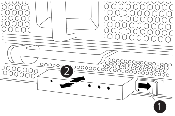

= FAS9500 시스템의 LED USB 모듈을 교체합니다
:allow-uri-read: 
:icons: font
:imagesdir: ../media/

[role="lead"]
FAS9500 시스템의 LED USB 모듈은 콘솔 포트 연결 및 시스템 상태 표시 기능을 제공합니다. 교체 시 툴이 필요하지 않으며 서비스 중단 없이 수행할 수 있습니다.

[[step-1-replace-the-led-usb-module]]
== 1단계: LED USB 모듈을 교체합니다

.단계
. 이전 LED USB 모듈을 분리합니다.
+
.애니메이션 - LED-USB 모듈 제거/설치
video::bc46a3e8-6541-444e-973b-ae78004bf153[panopto]
+

+
[cols="20%,80%"]
|===

 a| 

 a| 
잠금 버튼

 a| 
image::../media/icon_round_2.png[설명선 번호 2]
 a| 
USB LED 모듈

|===
+
.. 베젤을 분리한 상태에서 섀시 전면의 왼쪽 하단에 있는 LED USB 모듈을 찾습니다.
.. 래치를 밀어 모듈을 부분적으로 꺼냅니다.
.. 베이에서 모듈을 당겨 중앙판에서 분리합니다. 슬롯을 비워 두지 마십시오.

. 새 LED USB 모듈을 설치합니다.
+
.. 모듈 모서리의 홈이 섀시의 슬라이더 래치 근처에 위치하도록 모듈을 베이에 맞춥니다. 베이는 모듈이 거꾸로 설치되는 것을 방지합니다.
.. 모듈이 섀시와 완전히 맞닿을 때까지 베이에 밀어 넣습니다.
+
모듈이 미드플레인에 제대로 연결되면 딸깍 소리가 납니다.

[[step-2-return-the-failed-component]]
== 2단계: 장애가 발생한 구성 요소를 반환합니다

. 키트와 함께 제공된 RMA 지침에 설명된 대로 오류가 발생한 부품을 NetApp에 반환합니다.  https://mysupport.netapp.com/site/info/rma["부품 반환 및 교체"^]자세한 내용은 페이지를 참조하십시오.

